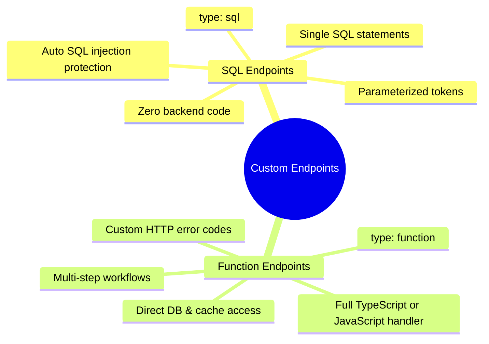

# Introduction

While ROSS automatically generates standard CRUD, Search, and Aggregate REST endpoints for your data models, real-world backends often need specialized endpoints that go beyond generic table operations.

**Custom Endpoints** give you the power to define arbitrary HTTP routes with custom logic directly in your ROSS configuration without losing framework guarantees like automatic JSON Schema validation, OpenAPI/Swagger documentation, rate limiting, CORS protection, and Role-Based Access Control (RBAC).

## What Custom Endpoints Can Do

With Custom Endpoints, you can:

- **Expose Custom HTTP Routes**: Mount any standard HTTP verb (`GET`, `POST`, `PUT`, `PATCH`, `DELETE`) with flexible route paths and path parameters (e.g., `/projects/:projectId/teams/:teamId/report`).
- **Enforce Strict Schema Validation**: Attach JSON Schemas to validate inputs across path parameters, query parameters, request bodies, and incoming headers before execution.
- **Auto-Generate OpenAPI Documentation**: Custom endpoints and their parameter/body schemas are automatically documented in your Swagger/OpenAPI interactive explorer (`/api/docs`).
- **Protect with Authentication & RBAC**: Apply fine-grained access policies using the `apis` configuration section—enforcing JWT authentication and allowed user roles (`roles: ["admin", "manager"]`).
- **Access Framework Runtime Decorators**: Direct, uniform access to the database abstraction (`app.db`), caching engine (`app.cache`), and resolved configuration (`app.appConfig`).
- **Standardized Response Envelopes**: All successful responses and domain errors are automatically wrapped in ROSS's consistent envelope format (`{ code, message, data }`).

## Supported Endpoint Types

ROSS currently provides **two** custom endpoint handler types:

| Type | Handler Identifier | Best Used For | Documentation |
| --- | --- | --- | --- |
| **SQL Query Endpoints** | `type: "sql"` | Complex SQL queries, multi-table joins, reporting aggregations, and raw updates defined directly in JSON. | [Custom SQL Endpoints](./sql.md) |
| **Function Endpoints** | `type: "function"` | Custom TypeScript or JavaScript business logic, external API integrations, multi-step workflows, and cache lifecycles. | [Custom Function Endpoints](./function.md) |

## Choosing Between SQL and Function Handlers

Use this quick guide to decide which handler type fits your use case:

### When to choose SQL (`type: "sql"`)

- You need a complex `JOIN`, `GROUP BY`, or aggregate calculation across existing database tables.
- You want to expose a query directly from configuration without writing or maintaining separate TypeScript source files.
- You need parameterized queries with safe, typed token substitution (`[[path.id:integer]]`, `[[query.status:string]]`).

### When to choose Function (`type: "function"`)

- You need to perform multi-step business logic or validate data semantically against external rules.
- You need to call external third-party services or HTTP APIs.
- You want to read/write from `app.cache` to implement custom caching strategies.
- You need to throw custom domain errors with specific HTTP status codes (`404`, `409`, `422`).
